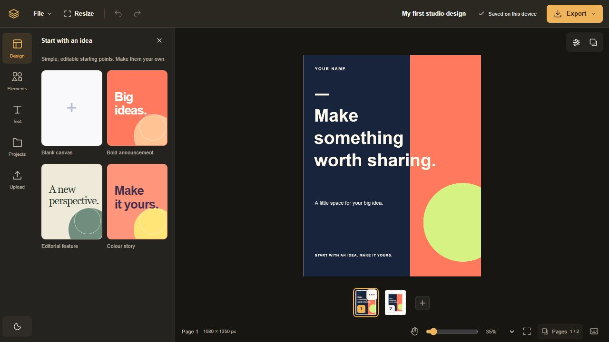

# Open Design Studio

A local-first browser editor for social posts, posters and carousels. Built with React, TypeScript and Fabric.js, with editable elements and portable project files.



## First milestone

- Create designs with multiple pages, text, rectangles, ellipses and uploaded images.
- Select, resize, rotate, arrange, duplicate, hide and lock elements.
- Pan and zoom the workspace, use keyboard shortcuts, and undo or redo edits.
- Snap to other elements' edges and centers while dragging, or align to a page or reference layer with six alignment controls. Hold Alt to bypass snapping.
- Save projects in a browser library with autosave.
- Download and reopen editable `.design.json` projects with images embedded.
- Export PNG, JPEG or SVG, or download all pages in a ZIP.

The editor runs without an account or backend. This milestone covers static designs. Cloud storage, live collaboration, AI generation, Adobe Illustrator `.ai` editing and vector-file import are future work.

## Run locally

Use **Node.js 22.22 or newer** and npm.

```sh
npm install
npm run dev
```

Open the local URL printed by Vite. Keep using the same hostname and port to access the same browser library.

To create a production build:

```sh
npm run build
npm run preview
```

`build` runs TypeScript checking followed by Vite's production build. `preview` serves that build locally. Serve the generated `dist/` directory with a static web host for deployment; the development and preview commands are local development tools.

## Your designs and browser storage

Projects and their embedded images are saved in IndexedDB in the current browser profile, under the site's origin. Publishing or contributing to this repository does not publish your browser library. Sharing a project requires downloading it and sending the file yourself.

Browser storage is best effort. A browser may deny storage, run out of space, or remove stored data. Clearing site data, using a different browser profile, or changing the site's hostname or port can make the library unavailable. Private browsing may discard it when the session ends.

**Download a `.design.json` backup for work you need to keep.** A PNG, JPEG or SVG export is an output image; the native project is the supported way to reopen all pages and editable elements.

This milestone provides no accounts, cloud backup or access controls. Anyone using the same browser profile can access its local projects. Imported images are embedded in the project file, so project downloads can contain the full original image bytes.

## Images and exports

Upload PNG, JPEG or WebP images. Images are kept as embedded data URLs; project files do not reference a cloud asset library. The importer checks image format and size limits before accepting files.

Raster exports are available at 1× and 2×, within the export size limit. JPEG exports flatten transparent areas onto white. SVG is resolution independent, but text remains text: the receiving application needs a matching font, and substitutions can change layout. Fonts are not embedded or converted to outlines.

Exporting SVG does not provide SVG re-import or native Illustrator `.ai` editing. Flattened artwork stays a single image element; the editor does not automatically separate it into text and objects.

See [Project format](docs/PROJECT-FORMAT.md) for the file structure and limits.

## Align elements

Select an element and use the **Align element** icon to open its alignment controls. Choose the page or a visible reference layer, then align left, right, top, bottom, or either center. Locked reference layers stay in place.

Dragging also snaps to nearby edges and centers, with temporary guides. The magnet button toggles snapping; hold **Alt** during a drag to bypass it. Guides are editor overlays and do not appear in saved projects or exports.

## Project structure

```text
src/
  core/       Project model, validation, storage, rendering and file/export helpers
  ui/         React editor interface and canvas interaction hooks
docs/
  PROJECT-FORMAT.md
```

The project document is the editable source of truth. Fabric objects render that model; viewport position and temporary selection are editor state. Storage and file export operate on the project model so a design can remain portable between editor releases.

## Contributing

See [CONTRIBUTING.md](CONTRIBUTING.md) for setup, review guidance and the separation between the design model and UI. Report security issues using [SECURITY.md](SECURITY.md).

## License

Open Design Studio's code is [MIT licensed](LICENSE), copyright 2026 imluri. Dependency licenses are listed in [THIRD_PARTY_NOTICES.md](THIRD_PARTY_NOTICES.md).

The software license does not grant rights to images, fonts, trademarks or other content you import. Only contribute assets you have permission to redistribute.
